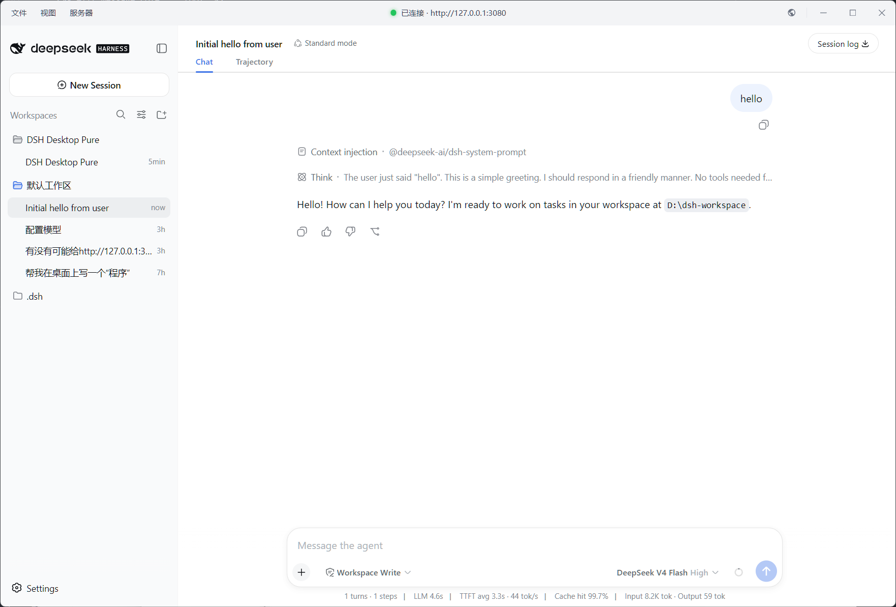

# DSH Desktop Pure

> A **zero-intrusion, pure-WebUI desktop shell** for DeepSeek Harness (`dsh web`): an Electron window that hosts the local Harness web app as a native desktop experience — **without modifying any DSH source code, resource, or configuration**.

[](./LICENSE)
[](https://www.electronjs.org)
[](#platform-support)

**Language**：🇨🇳 [中文](./README.md)（default） · 🇬🇧 [English](./README.en.md)

<p align="center">
  
</p>

## 📌 Fully independent from DSH (important)

**DSH Desktop Pure and DSH are completely independent projects that can be updated separately:**

- ✅ You can **update DSH alone without updating DSH Desktop Pure** — just run `npm update -g @deepseek-ai/dsh` and restart this app;
- ✅ The app and DSH can be updated independently, but DSH authentication or protocol changes may require a DSH Desktop Pure upgrade; v0.4.0's token-authentication adaptation is one example.
- ✅ The app has degradation paths for DSH reads; if a DSH update causes a compatibility issue, follow the guidance and upgrade the desktop shell when needed rather than assuming every older shell remains compatible.

## 🔐 DSH Web token compatibility

DSH introduced Token authentication for Web-interface access in **v0.1.2-alpha.1** (see the official [dsh-v0.1.2-alpha.1 release](https://github.com/deepseek-ai/deepseek-harness/releases/tag/dsh-v0.1.2-alpha.1), 2026-08-27). The currently tested DSH version is `0.1.2-rc.1`.

DSH Desktop Pure v0.4.0 supports the Token URL and `303`/cookie handshake emitted during automatic startup, complete-URL or token-only input for Windows manual authentication, remote-endpoint tokens, and title-bar token redaction with hover reveal. A Web token is not a model API key, and the app does not bypass authentication; compatibility with future DSH versions must still be checked against their authentication/protocol changes.

## Design principles

| Principle | Meaning |
| --- | --- |
| **Zero intrusion into DSH** | The shell contains **no DSH code, frontend assets, or configuration**; it never patches, hooks, or modifies anything in DSH's installation |
| **Read-only** | Every interaction with DSH is read-only: HTTP port probing, reading the stdout of a process *it* spawned, spawning/killing *its own* `dsh web` child |
| **Pure WebUI shell** | The UI is served by `dsh web` by default; the shell only draws **its own** title bar / dropdown menus / loading page / **built-in DSH Desktop Pure page** / tray (a few shell-owned static HTML files) and never injects into or modifies the Harness DOM |
| **No source modification** | The Harness page, the `window.__DSH_BOOT__` injection, and the `/api/*` RPC all come verbatim from the `dsh web` process; the shell just loads it and wraps it in desktop chrome |

## Features

- **Port policy (single port, never silently drifts)**: reuse first (a Harness already on the port → reused, marked "reused"); free port → auto-spawn `dsh web`; held by another process → dialog with **process name + PID**, "Retry / Close".
- **Self-drawn one-row title bar**: status dot (🔵 Pure page / 🟢 connected / 🟡 starting / 🔴 disconnected) + `File / View / Server` menus (pinned directly under the button, hover-switch while open) + "open in browser" + window controls (drawn on Win/Linux, native traffic lights on macOS); window title pinned to *DSH Desktop Pure*.
- **Built-in "桌面端配置" page (DSH Desktop Pure page)**: the "页面" button left of `File` in the title bar opens a dropdown to switch **桌面端配置 / DSH Web**. The Pure page mirrors the DSH Web settings-page style (four sections: Appearance / DSH Web / Changelog / About), supports light / dark, and offers a full-window / card layout toggle (persisted). The DSH Web section is a **multi-endpoint tab bar** — the host OS is auto-detected (Windows local), dsh web inside WSL is auto-detected and auto-spawned, and custom remote addresses can be added (persisted). When WSL / Node / DSH are not ready, WSL retains its four-step guide for installation and connection. When Windows local startup fails, a separate three-step guide checks external Node.js/npm, DSH, and startup connection. It supports copying manual commands, re-checking, and showing install progress/failure details. The Node one-click action uses winget to install `OpenJS.NodeJS.LTS`; without winget it points to [nodejs.org](https://nodejs.org/) for manual LTS installation. The DSH action runs `npm install -g @deepseek-ai/dsh`; installation occurs only after the user clicks. It is **fully independent of dsh web** — it works even when the server is down. The app starts on DSH Web; if it can't connect, it stays on the endpoint state page instead of exiting.
- **System tray**: `✕` or "File → Minimize to tray" hides the window while **the dsh server keeps running in the background**; tray right-click: Show window / Restart dsh server / Quit.
- **Restart dsh server**: one-click restart (works for self-spawned and reused instances) with a theme-aware loading page; the app **never quits** on restart; failures show a non-blocking warning and are retryable.
- **Theme**: light / dark / follow system (`nativeTheme`, persisted to `userData/theme.json`); shell UI re-skins automatically.
- **Hardened security**: renderer `sandbox` + `contextIsolation` + no `nodeIntegration`; only loopback navigation/popups; remote links go to the OS browser; all `<webview>` disabled.
- **Version-drift safe**: every read of DSH has a degradation path — a warning / conservative branch, **never a crash**.
- **Release check in About**: after the shell is ready, it performs one non-blocking automatic check of GitHub's latest stable Release; the About page still supports manual checks and shows `current` / `new` / `ahead` / `none` / `error` states. When an update is available, a yellow exclamation mark appears in the top-right; clicking it opens Desktop Settings → About and highlights the update area. No update notice is shown for an up-to-date result or a failed check. Release assets are offered as manual downloads through the system browser; the app never overwrites or executes an installer. Pre-releases are not default upgrade targets; rate limits or offline failures can be retried with Release-page fallback.

## 🔐 DSH Web token compatibility

DSH introduced Token authentication for Web-interface access in **v0.1.2-alpha.1** (see the official [dsh-v0.1.2-alpha.1 release](https://github.com/deepseek-ai/deepseek-harness/releases/tag/dsh-v0.1.2-alpha.1), 2026-08-27). The currently tested DSH version is `0.1.2-rc.1`.

DSH Desktop Pure v0.4.0 supports the Token URL and `303`/cookie handshake during automatic startup, complete-URL or token-only input for Windows manual authentication, remote-endpoint tokens, and title-bar token redaction with hover reveal. A token is not a model API key, and the app does not bypass authentication; compatibility with future DSH versions must still be checked against their authentication/protocol changes.
- **Windows token recovery**: after a newer token-based DSH starts successfully, the app encrypts and stores only the minimum recovery credential; if the desktop process exits abnormally while dsh web remains, the next launch verifies the listener identity (including a dynamic `--port 0` launch) and strictly validates the token 303/cookie handshake before reuse. Later health checks and session reuse use that handshake too. Normal exit stops only the verified recovery process and clears the record only after success; an unexpected child exit clears it. An explicit DSH 401 fails fast, and an arbitrary 401 is never treated as DSH. If another terminal started the instance and this app has never received its token, use the complete URL printed there.
- **Single instance**: re-launching focuses the existing window.

## Platform support

| Platform | Test status | Installer |
| --- | --- | --- |
| **Windows** | ✅ Fully tested | ✅ Released |
| **macOS** | ⚠️ Not tested yet | ⚠️ Coming soon |
| **Linux** | ⚠️ Not tested yet | ⚠️ Coming soon |

> Code-level platform branching is complete (process management, port discovery, window chrome, shortcuts, theme, tray); macOS / Linux users can build it themselves — test feedback and PRs are welcome.

## Roadmap

1. **Custom port** — `--port` / `DSH_DESKTOP_PORT` already work; planned: a friendlier in-UI configuration with persistence.
2. **Connect to a remote DSH Web** — point at a non-loopback `dsh web` instance (requires a security-model review; currently loopback only).
3. **Companion DSH plugin (desktop enhancement)** — a DSH plugin that enhances the desktop experience. **Positioning is explicit**: development focus **always stays on the desktop app itself**, and will **not** shift to "plugin ↔ desktop linkage"; the plugin is an **optional enhancement** — **without it, the vast majority of the normal experience is preserved**, and the desktop app never depends on the plugin.

## Install & run

1. **If Windows startup fails**: follow the three-step guide for Node.js/npm, DSH, and startup connection. The Node action uses winget; the DSH action runs the global npm install. You can also copy manual commands or re-check. Without winget, install the Node.js LTS release manually from [nodejs.org](https://nodejs.org/).

   Manual DSH installation:

   ```bash
   npm install -g @deepseek-ai/dsh
   ```

2. **Windows users**: download the Windows installer from [Releases](https://github.com/WJBFks/dsh-desktop-pure/releases), install it, and double-click to run.

> For building on other platforms, running from source, and command-line configuration, see the [detailed reference](./docs/DETAILS.en.md).

## More documentation

- 📖 **[Detailed reference](./docs/DETAILS.en.md)** — behavior / running from source / upgrading DSH / security / directory layout / packaging, for power users and contributors.
- 📝 **[Changelog](./CHANGELOG.en.md)** — notable changes per release ([中文](./CHANGELOG.md)).

## License

[MIT](./LICENSE) © 2026 WJBFks
